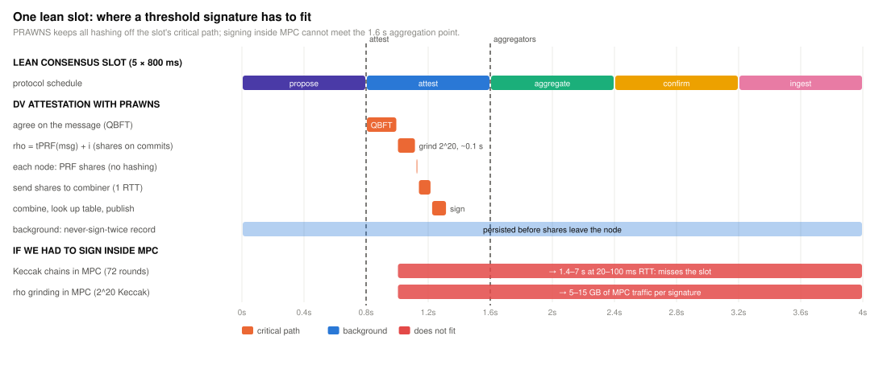
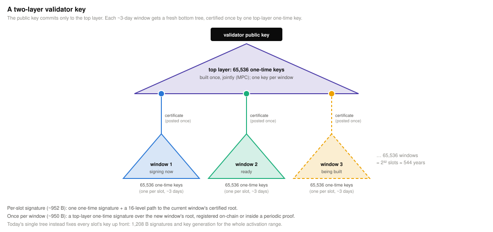
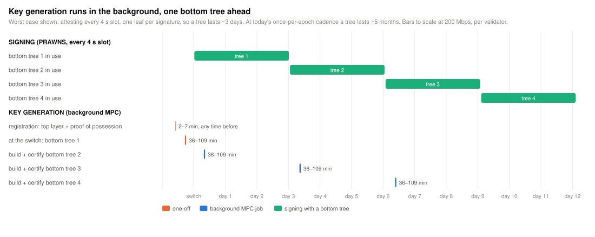
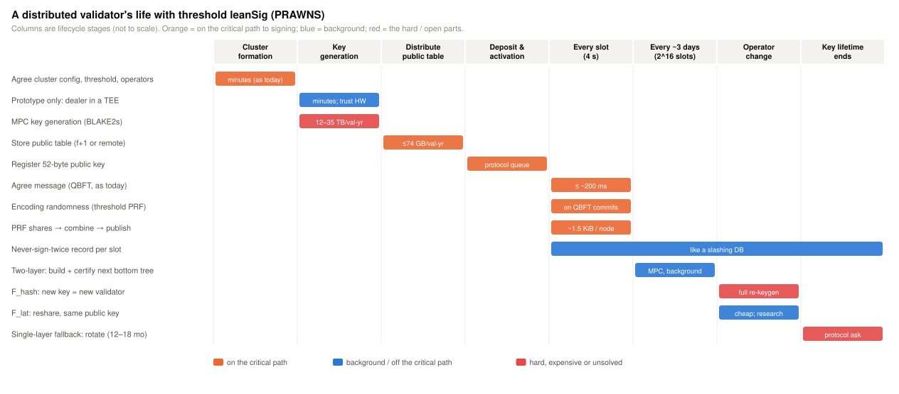
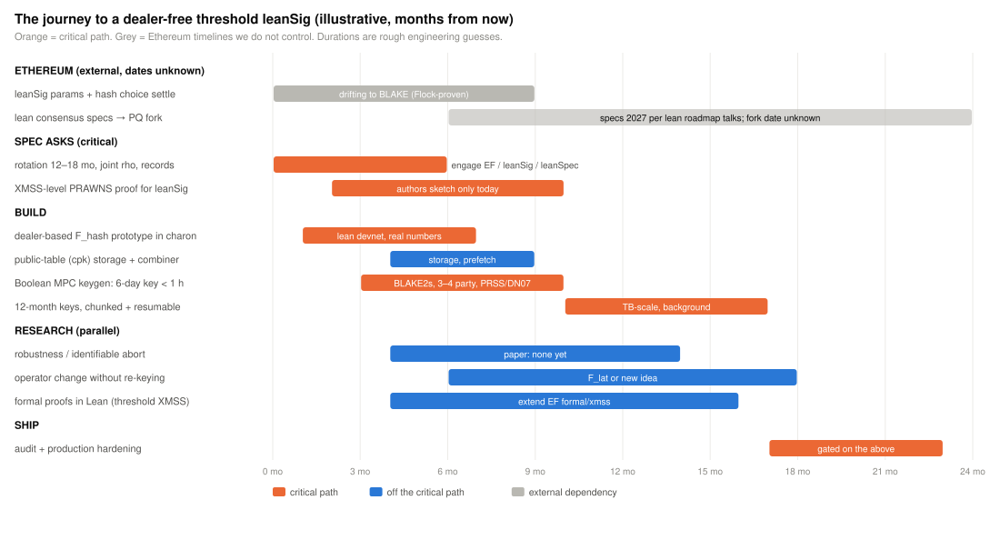

# pqdv: post-quantum distributed validators

**Distributed validators carry over to post-quantum Ethereum.** This repo shows how: how a cluster signs, how it
makes keys without anyone ever holding them, what it costs, and the protocol choices that make it smooth. Ethereum's
post-quantum key registry, [EIP-8450](docs/eip-8450.md), has now adopted the key structure this depends on.

## TL;DR

- **Threshold signing is solved.** With PRAWNS[^prawns], each node contributes its share alone, with no multi-party
  computation (MPC) and no hashing of secrets at signing time. The combined output is a **standard signature**, so
  aggregation and verification are unchanged.
- **Ethereum's key is DV-ready.** EIP-8450 registers one **two-layer leanXMSS key** per validator: a long-lived top
  key certifies a fresh bottom tree of 65,536 one-time keys whenever one is needed. The leanXMSS specification sketches
  the same threshold signer we propose.
- **Keys are made jointly, in the background.** A cluster generates keys by MPC, so no machine ever holds a full key.
  Per validator, per node, at 200 Mbps:
  - **register a key:** 2–7 minutes;
  - **each bottom tree:** 36–109 minutes, built one ahead. It's needed every few months at today's duty cadence, or
    every 3 days if attestations move to every 4-second slot;
  - **stored:** about 0.4–0.55 GB.

  No key lifetime to pick, and operator changes keep the same registered key.
- **What we still ask of Ethereum:**
  1. **a much higher maximum balance (2¹⁷–2²⁰ ETH):** every post-quantum cost is per key, so this means 64–512× fewer
     keys;
  2. recommend dense leaf allocation (fixed per-slot schedules cost DVs up to 128× more);
  3. state the bottom-tree rule as an outcome, not "derived from a seed";
  4. let a registered key authorize its own replacement;
  5. a threshold profile for post-quantum keystores.
- **Status:** the cryptography exists, the costs are known, and the registry lets DV keys go on-chain long before they
  sign anything. The [roadmap](#8-roadmap) starts with registration.

---

## 1. Why BLS made distributed validators easy

A BLS key is a number, and everything about it is **linear**. Shamir-split the key and any `t` partial signatures
combine into the signature the public key expects. A distributed key generation (DKG) takes seconds, and thousands of
signatures add up into one. The protocol never needs to know a validator is distributed.

## 2. What changes after the post-quantum switch

Ethereum replaces BLS with **leanXMSS**, a hash-based signature (two-layer XMSS over Keccak-256). Proofs replace
pairing-based aggregation.

| | BLS (today) | leanXMSS (post-quantum) |
|---|---|---|
| Secret | one number | a seed expanding into 2³² one-time keys, each 58 hash chains |
| Signature | algebraic, 96 B | reveals points on hash chains, plus two Merkle paths: 2,404 B |
| State | slashing protection | each leaf signs once, ever |
| Aggregation | add signatures | a zk proof that many standard signatures verify |
| Threshold signing | algebra | needs a new idea: **PRAWNS** |
| Distributed key generation | seconds | hashing secrets inside MPC: needs a key structure that allows background generation |

EIP-8450 registers these keys in one fork while BLS still signs every duty. A later fork switches duties to them.

## 3. How a DV signs

**PRAWNS** precomputes every hash-chain value at key generation and publishes each one *masked* by a threshold
pseudorandom function (PRF). To sign, nodes send PRF shares for the positions the message selects; a combiner unmasks
those positions and outputs an ordinary leanXMSS signature. No secret is hashed at signing time.

- **Randomness.** Signatures include a randomizer ρ. A DV uses ρ = threshold-PRF(key, message) + i, where i is the
  first value that makes the encoding valid. Nodes attach their PRF shares to the QBFT commit messages they already
  send, so this costs no extra round. It is unbiasable and deterministic, and verifiers can't tell it apart.
  - The leanXMSS threshold sketch derives ρ the same way, and EIP-8450 makes randomizer derivation
    non-consensus-critical.
- **Grinding.** Finding i takes about 2²⁰ Keccak permutations: we measured 0.12 s on five cores. It runs after the
  cluster agrees the message.
- **Threshold.** PRAWNS needs `t > (n + f)/2`, which charon's `ceil(2n/3)` already meets.
- **State.** Each node keeps a never-sign-twice record per leaf, like today's slashing protection.

Details: [`docs/prawns.md`](docs/prawns.md).

## 4. Two-layer keys, in plain terms

**A single-tree key** is a book of 4 billion single-use tickets. The public key fingerprints the whole book, so every
ticket must be printed before the key can be published.

**A two-layer key** works like a certificate chain:
- **Top layer:** a master book of 65,536 single-use stamps. The public key fingerprints only this book.
- **Bottom layer:** when the current ticket book runs out, a fresh book of 65,536 tickets is printed and stamped once
  by one master stamp.
- **Validity:** every signature carries its ticket, its book's stamp, and both fingerprint paths.

Same 2³² tickets, but only the master book plus the current ticket book ever need to exist.

| | single tree (height 32) | two layers (EIP-8450) |
|---|---|---|
| Signature | 1,460 B | 2,404 B |
| Verification (Keccak-f permutations) | 109 | 186 |
| Key generation, any validator | 2³² one-time keys: infeasible without a range | 2¹⁶ one-time keys: seconds |
| Key lifetime chosen up front | yes | no |
| Long-lived key | used for every signature | signs once per bottom tree, so it can stay **cold** |
| Distributed key generation | every leaf in the range, up front | the top layer once, then one bottom tree at a time |

Full analysis: [`docs/two-layer-keys.md`](docs/two-layer-keys.md). What EIP-8450 means for DVs:
[`docs/eip-8450.md`](docs/eip-8450.md).

## 5. How a DV makes keys

Without a trusted dealer, the hash chains behind each key have to be computed on secret data **inside MPC**. There is
no shortcut: hashing in the clear provably leaks enough for a minority to forge[^kk]. Two-layer keys make that MPC
small and steady:

Per validator, per node, Keccak-f in 3–4-party Boolean MPC:

| step | MPC traffic | at 200 Mbps | at 1 Gbps |
|---|---|---|---|
| **Registration:** top layer (2¹² real top keys) + proof of possession | 3.4–10 GB | **2–7 min** | 27–82 s |
| …with the full 2¹⁶ top tree | 55–164 GB | 36–109 min | 7–22 min |
| **Each bottom tree**, built one ahead | 55–164 GB | **36–109 min** | 7–22 min |

- **How often a bottom tree is needed** depends on duty cadence and on leaf allocation. With one leaf per signature:
  - today's chain (attest once per epoch): every ~5 months, about 0.1 Mbps;
  - per-slot attesting at 4 s: every 3 days, 1.7–5 Mbps, or 20–60 validators per node on half a 200 Mbps link.

  A fixed schedule of 8 leaves per slot would multiply these by 8 to 128.
- **Planning case: a tree every ~3 days.** With decoupled consensus (EIP-8453), head-vote committees are sampled by
  balance, so a large-balance key signs nearly every slot. That cost no longer grows with the key's ETH, which is why
  a higher maximum balance helps so much.
- **The top range.** Top keys that will never certify a tree can be random filler. 2¹² real ones last ≥ 34 years at
  4 s slots, at 1/16 of the cost.
- **Latency doesn't matter.** Keccak has AND-depth 24, so a whole tree is about 72 MPC rounds deep.
- **Storage:** about 0.4–0.55 GB per validator per node:
  - top-layer secret shares, kept for life (11–182 MB);
  - two bottom trees' signing tables (365 MB).
- **Operator changes:** reshare the top-layer shares (a standard Shamir reshare), and the new operator set builds the
  next bottom tree. Same validator, same registered key.

Model and assumptions: [`docs/dkg-and-mpc-costs.md`](docs/dkg-and-mpc-costs.md).

## 6. A validator's life

| stage | what happens | resources (per validator, per node) |
|---|---|---|
| Cluster formation | agree config, threshold, operators | as today |
| Registration (EIP-8450 fork) | MPC builds the top layer, signs a proof of possession; the cluster BLS-signs the registration once | 2–7 min at 200 Mbps |
| Dormant period | keys registered, BLS still signs duties; reshare on operator changes | none |
| Switch fork | MPC builds the first bottom tree; the top key certifies it | 36–109 min at 200 Mbps |
| Every signature | QBFT → threshold randomness on commits → grind → PRF shares → combine → publish | ~1–2 KiB, ~0.1 s CPU |
| Each new bottom tree | built in the background one tree ahead | 36–109 min at 200 Mbps |
| Always | never-sign-twice records for leaves and certifications; ≤ 0.55 GB key material | |

## 7. What we ask of Ethereum

EIP-8450 settled our earlier top asks: two-layer keys, threshold-friendly randomness, one key for all duties, and
replacement without exit. What remains:

| | ask | why it matters |
|---|---|---|
| 1 | **A much higher maximum effective balance: 2048 → 2¹⁷–2²⁰ ETH** | registrations, registry state, 2.4 KB signatures to aggregate, grinding and DV key generation are all per key; consolidated stake needs 64–512× fewer keys |
| 2 | **Recommend dense leaf allocation**, and keep the switch fork allocation-agnostic | every bottom tree is an MPC for a DV; fixed per-slot schedules cost up to 128× more |
| 3 | **State the bottom-tree rule as an outcome**: a top key never certifies two roots | threshold signers have no seed to derive trees from |
| 4 | **Key-authorized replacement**: a registered key signs its successor | rotation for validators whose withdrawal contract can't make the owner-path request |
| 5 | **A threshold profile for EIP-8310 keystores** | shares, tables and certification records instead of a seed |
| 6 | weigh grinding (2²⁰ trials per signature) against verification | it sits after consensus for threshold signers |

Why two-layer keys make staking more secure:
- **No forced single point of failure.** Without a threshold-friendly key structure, every post-quantum validator key
  would have to live whole on one machine. One compromise could make it slashable, and one outage takes it offline.
- **A cold root for everyone.** The long-lived top key signs once per bottom tree, so it can stay offline. A hot-machine
  compromise exposes only the trees that machine holds.

Ranked detail: [`docs/ethereum-design-decisions.md`](docs/ethereum-design-decisions.md).

## 8. Roadmap

The critical path, registration first:
1. **charon: BLS-authorized registration.** Sign `PQKeyRegistration` once per validator and broadcast it. Test with
   dealer keys on devnets.
2. **Top-layer MPC key generation** and the proof of possession.
3. **Owner path:** PQ key authorization in withdrawal contracts (on hold).
4. **Top-layer resharing** across the dormant period.
5. **Then, as the switch fork takes shape:** bottom-tree MPC, PRAWNS signing, the leaf allocator, and a threshold
   two-layer security proof. Audit and hardening.

## 9. Open questions

- **The switch fork's duty cadence:** once per epoch or every slot. It sets the DV's MPC rate by about 16×.
- **Final parameters:** EIP-8450 is a Draft following an unmerged leanVM branch. Build the MPC parametric in the hash.
- **Real-network MPC throughput:** bits per AND gate for a production 3–4-party protocol. Our range assumes 1–3 bits.
- **Ceremony UX:** progress, checkpointing and failure handling, and one-shot registration signing.

## 10. Verdict

- **Signing: ready.** Non-interactive, cheap, standard output.
- **Keys: viable and simple** on EIP-8450's two-layer keys: minutes to register, then a background job per bottom tree.
  No single machine ever holds a key, and operator changes keep the validator.
- **Distributed validators in post-quantum Ethereum are a *when*, not an *if*.** The key structure is in the EIP; the
  remaining steps are known engineering, a proof, and a few clarifications that help every staker.

## Further reading

| | |
|---|---|
| [`docs/eip-8450.md`](docs/eip-8450.md) | EIP-8450 read for DVs: issues, opportunities, what to build now, asks |
| [`docs/two-layer-keys.md`](docs/two-layer-keys.md) | the two-layer design: options, sizes, security rules, DV design, prior art |
| [`docs/prawns.md`](docs/prawns.md) | PRAWNS construction, threshold condition, randomness, why key generation needs MPC |
| [`docs/dkg-and-mpc-costs.md`](docs/dkg-and-mpc-costs.md) | cost model: per-hash MPC costs, key generation, storage, earlier BLAKE2s and Poseidon estimates |
| [`docs/ethereum-design-decisions.md`](docs/ethereum-design-decisions.md) | ranked asks, maximum balance, equivocation rules, The Extremely Lean Chain |
| [`docs/alternatives.md`](docs/alternatives.md) | helpers that may only cost liveness, TEE, FHE, Stoffel MPC, Flock |
| [`docs/leansig.md`](docs/leansig.md) | leanXMSS and earlier leanSig parameter sets, key generation structure, slot usage |
| [`tools/`](tools/) | `cost_model.py --primary` (this page's numbers), `--option-b`, `--blake`, `kk_leak.py`, `kk_multitarget.py`, `figs.py` |
| [`doc/`](doc/), [`mpspdz/`](mpspdz/) | prior work (2025): *Towards Threshold Hash-Based Signatures for Post-Quantum Distributed Validators*, with MP-SPDZ benchmarks that calibrate our MPC costs |

## References

[^prawns]: Boneh, Bünz, Justin D., Litchev, Nazirkhanova. *PRAWNS: Threshold Hash-Based Signatures from Threshold PRFs*. IACR ePrint 2026/2142. <https://eprint.iacr.org/2026/2142>
[^kk]: Kondi, Kumar. *A Black-Box Impossibility Result for Threshold Signing Standard Hash-Based Signatures*. IACR ePrint 2026/2194. <https://eprint.iacr.org/2026/2194>

Also: *EIP-8450: Post-Quantum Validator Key Registry* <https://eips.ethereum.org/EIPS/eip-8450> · *EIP-8310:
Post-Quantum Keystore for Stateful Keys* <https://eips.ethereum.org/EIPS/eip-8310> · *The Extremely Lean Chain*,
ethresear.ch, July 2026 <https://ethresear.ch/t/the-extremely-lean-chain/25369> · *Flock: Fast Proving for Batch
Boolean Computations*, ePrint 2026/1329 <https://eprint.iacr.org/2026/1329> · leanVM (leanXMSS)
<https://github.com/leanEthereum/leanVM> · leanSig <https://github.com/leanEthereum/leanSig> · leanSpec
<https://github.com/leanEthereum/leanSpec> · HoneyBadgerMPC, ePrint 2019/883 <https://eprint.iacr.org/2019/883>
